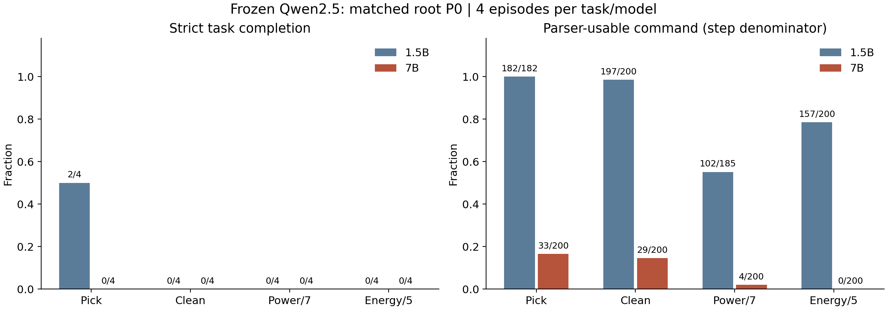
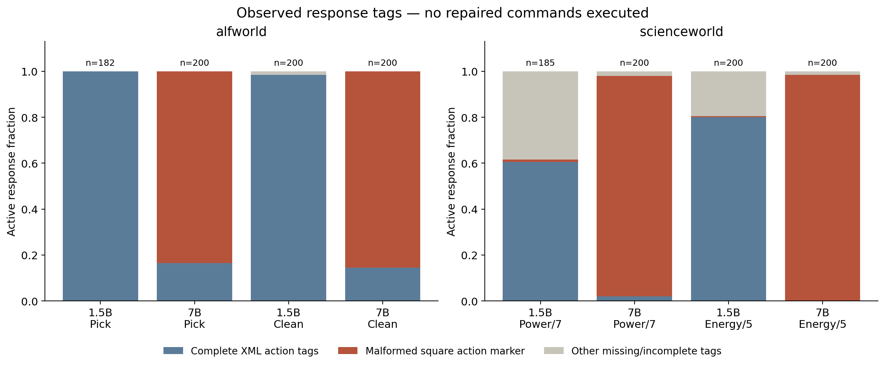
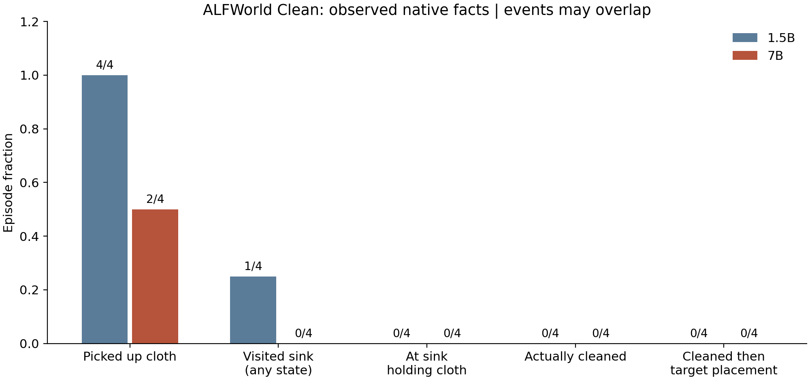
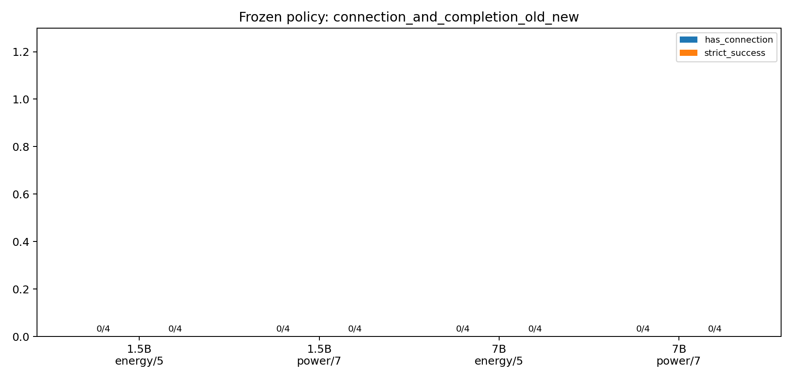

# Qwen2.5-7B 两环境 P0 实测复核

复核日期：2026-10-13（Asia/Shanghai）。状态：`completed_exploratory`；这表示计划内采样与诊断完成，不表示环境任务成功。没有训练更新、追加重采样、P1、技能 probe、SFT、其他 benchmark 或计算成本对照。

## 数据、模型与比较条件

| 环境 | 新 P0 | 主历史基线 | 实际新数据 |
|---|---|---|---|
| ALFWorld | `alfworld-p0-7b-20261012T154819Z-a2499e`，job 159779 | `alfworld-collect-20261012T095303Z-d56e91` | 2 题 × 4 条 × 50 步 = 400 步 |
| ScienceWorld | `scienceworld-p0-7b-20261012T154815Z-46bd69`，job 159780 | `scienceworld-rep0-20261012T132744Z-7d238f`，job 159710 | 2 题 × 4 条 × 50 步 = 400 步 |

所有 16 条轨迹均以预算耗尽终止，状态记录为 complete，完整成功均为 false，没有 infra_error。每个 episode group 恰有四条、共四组；800 个 step ID 唯一。history_offset 为零、没有 hint、没有 replay。1.5B 基线未重新采样，分析另存 `alfworld/old_reanalysis` 与 `scienceworld/old_reanalysis`。不是 ALFWorld 提示续接，也不是最早的 ScienceWorld 旧接口。

两个 `model_identity.json` 一致：7B revision `a09a35458c702b33eeacc393d103063234e8bc28`，参数 7,615,616,512、FP16、device map GPU 0。所有新 episode 的 checkpoint_id 匹配。tokenizer 四个文件与本地缓存哈希完全一致，因而可用本地 tokenizer 逐步解码复核；本地缓存目录名含 1.5B 不影响这个按内容哈希验证的事实，实际 HPC 模型身份单独记录。

逐步复核结果：800 条回答的 token IDs 解码与 raw_response 全相同；800 个实际输入解码与完整 rendered_prompt 全相同；800 次动作重新按原 parser 提取，与记录的实际命令和格式标志全相同。16 个首次 actor prompt、16 个 reset 观察与相应历史实例一致。全部新回答未达到 512 token 上限，输入未截断。16 条轨迹的首轮已出现错误方括号标签，因此不能仅用后续错误 history 回流解释最初的格式问题；history 是否放大问题仍需另外验证。

ScienceWorld package/JAR/wrapper 与 159710 一致，JAR SHA256 为 `f4e1fdce0cdabe1bab7128a7e78ea820210d9db3c28d7272bcbbc3f3a1c5f0d7`；prompt 为 reference_interface_v1，parser 为 p0_original_unchanged，simplifications 为空。两环境采样和奖励配置与基线匹配，模型版本差异单列，具体见两个 `comparison_config_diff.json`。

下载包可完整读取，记录了所有解包文件的本地 SHA256，并核对内附实现快照哈希。未提供远端 `.sha256` 文件，因此没有声称做过远端与本地包哈希比对。原始结果与远端分析保持只读；本次本地复算另存，所得 analysis.json 与 HPC 完全一致。

## 观察一：7B 的输出格式严重限制了实际交互

| 环境与任务 | 1.5B 严格完成 | 7B 严格完成 | 1.5B 格式合规 | 7B 格式合规 | 1.5B parser 可用 | 7B parser 可用 |
|---|---:|---:|---:|---:|---:|---:|
| Pick | 2/4 | 0/4 | 154/182 | 33/200 | 182/182 | 33/200 |
| Clean | 0/4 | 0/4 | 149/200 | 29/200 | 197/200 | 29/200 |
| Power/7 | 0/4 | 0/4 | 40/185 | 4/200 | 102/185 | 4/200 |
| Energy/5 | 0/4 | 0/4 | 144/200 | 0/200 | 157/200 | 0/200 |

格式合规、命令可提取、环境接受与实际状态变化是不同层次。1.5B 的大写 action 标签有时导致原格式标志为 false，但原执行 parser 忽略大小写，命令仍可用，因此两列不能合并。7B 的主要缺陷则是 `[action]`、`[action>`、`[action:...]` 等错误边界，不能被原 parser 识别为完整 `<action>...</action>`。

7B ALFWorld 338/400 条回答有错误方括号标记，其余 62 条有完整 XML 动作标签；实际反馈 347/400 为 `Nothing happens.`。后一个反馈不是专用的语法错误码，也可能表示前置条件不足，不能把 347 步全部归因为格式。

7B ScienceWorld 389/400 条回答有错误方括号标记，另 7 条缺失/不完整，只有 4 条完整动作标签。环境 396/400 步返回 `No known action matches that input.`。剩下四步是两次 `go to workshop` 被关门阻挡、两次 `look around` 成功返回观察。没有任何实际开门、focus 成功或 connect 命令。

例如 Power 轨迹 `afadbee7-1282-4047-bfeb-01a1e2cbcce2` 第 1 轮（step 0）回答尾部为 `[action]go to workshop`，实际执行的是 `/think>\n[action]go to workshop`，收到无法匹配动作。第 2 轮（step 1）正确输出并执行 `go to workshop`，环境明确反馈 `The door is not open.`；第 3 轮又输出 `[action>go to workshop</action>`。这也说明，即使格式正确，仍有基本操作前置条件需要解决，不能假定修正标签就必然成功。

## 观察二：未出现可确认的清洁或接线准备

| Clean 事件（episode 分母） | 1.5B | 7B |
|---|---:|---:|
| 成功取任务相关布 | 4/4 | 2/4 |
| 任意状态到水槽 | 1/4 | 0/4 |
| 持布到水槽 | 0/4 | 0/4 |
| 持布时有 clean 菜单命令 | 0/4 | 0/4 |
| 实际 clean 尝试 / 真实 isclean | 0/4 / 0/4 | 0/4 / 0/4 |
| 先清洁同一布再目标放置 | 0/4 | 0/4 |
| 已知未清洁时目标放置 | 4/4 | 0/4 |
| 首次取布后下一决策直接放未清洁布 | 3/4 eligible | 0/2 eligible；另 2 条未取布 |

7B 的两次真实取布分别是 cloth 1（轨迹 `77d4edc4-4333-4afa-b993-7cfc6439740f`，step 8）与 cloth 3（`f3bb8447-f3f6-445d-82fb-a338abfe2f9a`，step 26），没有限定必须 cloth 4。前者下一轮执行畸形 `ction>examine cloth 1</action>`，反馈 Nothing happens；后者下一轮正确执行 `examine cloth 3`，反馈 `There's nothing special about cloth 3.`，再下一轮仍查看。没有 isclean 事实、持布到水槽或目标放置。故 0/2 只能描述“没有立即放脏布”，不能解释成准备行为改善。

Pick 的清洁字段为 N/A。7B Pick 四条均未取到 creditcard，也未放到 sofa；1.5B 原始 P0 有两条完成。每题 n=4，模型表现差异与大量格式失败共同存在，不能从这里推断一般性的规模规律。

ScienceWorld 新 P0 的两题各 0/4 有 focus 成功、0/4 有连接、0/4 完成。实际首词严格为 connect 的命令数为 0，不能把思考中谈到连接或 malformed 标签里残留的语句记成接线尝试。Power/7 四条始终在 hallway，未进入 workshop，分数始终 0；Energy/5 四条 reset 就在 workshop，分数始终 5，不能称为后续进入或新增进展。1.5B 接口版 Energy/5 有 3/4 成功 focus、最终 38 分，但仍 0/4 真实连接和完成。

## 观察三：本轮信用信号全部退化为零

全部新步骤的研究奖励为零，16 条终局回报均为零。按原 GiGPO mean_norm、gamma=.95、step 权重 1、精确动作前 anchor 重算，800 步的 AE、AS、联合优势均为零；本地与 HPC 差异为 0，核心分解恒等式残差为 0。未通过原生 partial score、非法动作惩罚或奖励修改制造信号。

| 正常观察下跨轨迹异动作支持 | 1.5B | 7B |
|---|---:|---:|
| Pick | 63/111 | 0/8 |
| Clean | 83/107 | 0/3 |
| Power/7 | 16/25 | 无可用分母（0 个 parser 可用正常 anchor 步骤） |
| Energy/5 | 53/61 | 无可用分母（0 个 parser 可用正常 anchor 步骤） |

这是完整采样组中、parser 可用且 pre-anchor 非通用报错的步骤分母。GiGPO 原分组本身未过滤这些步骤；分离只用于解释。7B ScienceWorld 通用报错 pre-anchor 占 388/400，平均组大小 80 主要反映相同报错反复出现。四个可用动作都处于通用报错 anchor，因此整体可用动作支持 4/4 也不能代表准备性行动的丰富性。没有可用分母的正常支持显示为 unavailable，不填 0%。

历史 1.5B Pick 的两成功两失败仍产生非零 AE 182/182、非零 AS 130/182；Clean 与两个 ScienceWorld 任务为零。报告没有把 1.5B 提示 P1 的零优势或后缀数据混入主对照。

## 后续判断与交付索引

当前数据支持“这个固定接口下 7B 大量失败发生在输出格式与最基本执行层”，不能回答它在格式稳定后能否更好组织子目标依赖。没有成功清洁或接线片段，现阶段对准备性行动的学习机制做强结论缺少证据。

下一轮最有价值的两项：

1. 保留本轮所有失败结果，设计 2–4 条短的输出格式对照：只比较明确格式示例/输出约束，任务、奖励、原 parser 保持固定，不给设施编号、连接答案或清洁命令；单独标记接口版本，并检查实际 token、唯一命令和环境执行。这里只是建议，未运行。
2. 格式稳定后，再从原始 reset 检查基本操作、真实清洁和真实连接，决定是否做完整 P0；若要跨模型比较改过的接口，需要明确新对照条件。暂不直接转入提示 P1 或 RL；也不把离线改写标签当作新轨迹成功。

主表：`task_comparison.csv`；episode 明细：`all_episode_outcomes.csv`；标签计数：`format_failure_counts.csv`；800 步标注：`format_annotations.jsonl`；可定位案例：`case_steps.md` 和本地 `case_steps.jsonl`（含原始状态事实）；验证：`audit.json`、`recompute_verification.json`、`source_index.json`。完整运行命令见 `RUN_COMMANDS.md`，实现与局限见 `IMPLEMENTATION_DIFF.md`。图提供 PNG 和 SVG，数值全由上述实际文件生成。

采样提交：`1de2441b051ae8e1eecf38f3c769abb03e029916`，原分支 `exp/dep-prep-p1-sci-rep0-20261012`。SwanLab 均为 cloud，finish_status=completed：[ALFWorld](https://swanlab.cn/@KANSEI/gigpo-dependency-pilot/runs/w5i38pgj)、[ScienceWorld](https://swanlab.cn/@KANSEI/gigpo-dependency-pilot/runs/2ybv3b5x)。本地复核没有新增云端实验。
