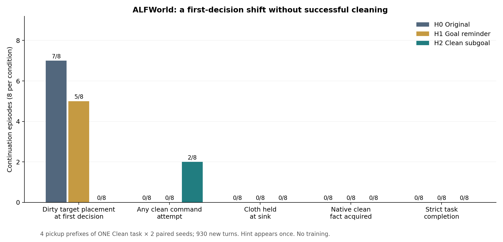
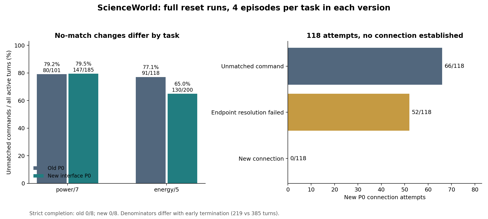
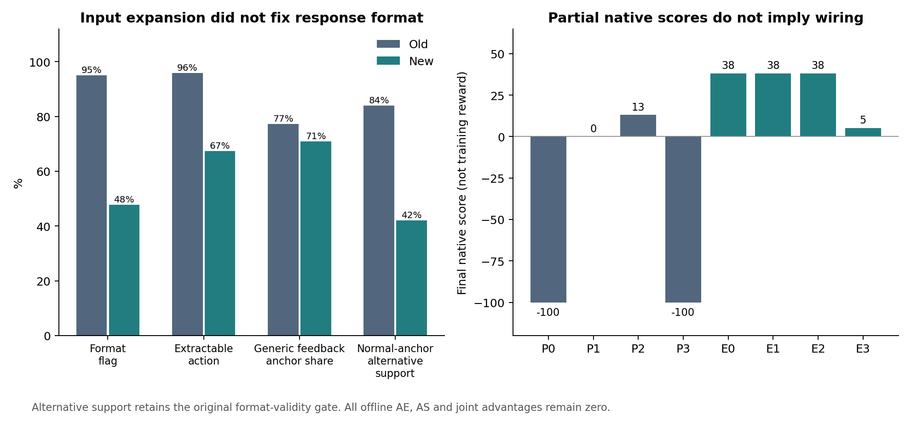

# ALFWorld P1 与 ScienceWorld 新 P0：下载结果复核

2026-10-12；仅研究子目标依赖与准备性行动。**本轮要求的真实采样与分析已完成；两环境都没有严格成功。** 失败结果提供了下一步定位依据，但还不能支持训练算法优劣或准备性行动的信用分配结论。

## 1. 三个主要观察

1. **清洁子目标提示改变了 ALFWorld 的首步选择，没有转化为实际清洁。** 首步把未清洁布放进目标马桶的比例由无帮助的 7/8 降为 0/8；清洁提示组有 2/8 发出清洁命令，却都不在当前位置合法动作中。三个条件均没有一次拿着布到达水槽，原生 `isclean` 与严格完成均为 0。
2. **ScienceWorld 接口信息确实进入了模型输入，但模型仍未建立一条连接。** 完整新 P0 共 118 次 connect 尝试：66 次命令不匹配，52 次端点解析失败。energy/5 的 no-match 比例下降，power/7 基本不变。部分 native score 来自 focus、导航或初始分，不能替代成功接线。
3. **当前缺少可用于识别信用分配现象的回报差异。** ALFWorld 930 步、ScienceWorld 385 步的终点奖励、离线 AE/AS/联合优势全部为零。重算与 HPC 保存值的最大绝对误差为 0。此时不能把“有动作差异”写成“GiGPO 已识别准备性行动”，也不能把失败归因于 GiGPO。

## 2. 已运行的范围与有效性

| 项目 | 已核验结果 |
|---|---|
| ALFWorld P1 | 4 个旧 Clean 取布前缀 × 3 提示条件 × 2 seed；24 条续接、930 个新 agent turns |
| 剩余预算 | p1/p2/p3/p4 分别 39/35/47/34；每条原前缀加续接恰好 50 轮 |
| 实际重放 | 270 步，逐步比较原始 typed facts、反馈、合法动作、moves、native score 等全部相同；重放不计新 rollout |
| 历史与提示 | 24/24 首次续接的未加提示 prompt 与旧轨迹下一决策完全一致；16 条有提示续接首步可见，后续消失；H0 没有注入提示 |
| P1 优势分组 | 12 个组，每组同 prefix、同 condition 的 2 条；没有跨提示或跨前缀分组 |
| HPC ScienceWorld smoke | 2 条 × 12 轮，24 步；原生通信、接口可见性及只读查询通过后锁定 S1 |
| 完整 ScienceWorld 新 P0 | 两个原任务各 4 条，从原始 reset 开始，每条最多 50 轮；8 条、385 步 |
| 新 P0 终点 | 6 条以预算耗尽结束，2 条原生 task failure；其中 1 条失败发生在第 50 轮，因此共有 7 条走到 50 轮 |
| 输入与观察者 | 全部 1,339 个新决策（含 smoke）的保存输入 IDs 可由实际 rendered prompt 重编码复现；无输入截断；ScienceWorld 409 步对象块完整可见且无对象裁剪，电气只读查询不增加 moves |
| 解析器 | 重新解析旧 SW、新 SW、新 ALF 共 1,534 步，执行命令全部与原记录一致；主对照未加严格唯一动作保护 |
| 文件完整性 | 导入包 136 个文件的 SHA256 在分析前后全部一致；原始 JSONL、HPC 指标均保留 |

本次审计 27 类检查通过；代码检查 20 项通过。第一次本地检查因沙箱默认临时目录无法创建而出现 3 个 setup error；指定工作区内临时目录后全部通过。没有额外生成模型轨迹。

四个 ALF 前缀都来自同一个任务实例 `train/pick_clean_then_place_in_recep-Cloth-None-Toilet-402/trial_T20190906_201431_394089`，不是 24 个独立任务。每条件 8 条由 4 个前缀和 2 个配对 seed 构成。续接 seed 为 10000/10001，按绝对轮次偏移；H0 是新采样，不能误称逐字复用旧续接。重放验证覆盖已记录状态与历史，不声称恢复未保存的隐藏 RNG 快照。

## 3. ALFWorld P1 结果

| 轨迹级事件，每条件 8 条 | H0 无帮助 | H1 重申原目标 | H2 提示先清洁 |
|---|---:|---:|---:|
| 首步直接放置未清洁布到目标马桶 | 7/8 | 5/8 | 0/8 |
| 到过水槽，不限定持物 | 1/8 | 2/8 | 1/8 |
| 拿着布到达水槽 | 0/8 | 0/8 | 0/8 |
| 发出 `clean cloth...` 命令 | 0/8 | 0/8 | 2/8 |
| 获得原生清洁事实 | 0/8 | 0/8 | 0/8 |
| 续接期间发生清洁前目标放置 | 8/8 | 8/8 | 7/8 |
| 严格完成 | 0/8 | 0/8 | 0/8 |

H2 首步：4 次 examine cloth、1 次尝试重新 take 已持有的 cloth、2 次不合法的 clean、1 次提到了 clean 但被原 fallback 截成畸形命令。最后一种不计为清洁尝试。仅不立即放置并不证明实施了准备性行动。到达水槽的 4 条续接全部空手，不能把“到了设施”与“具备清洁前提”混为一谈。

H1 与 H0 有 5/8 配对轨迹的全段动作序列完全一致，H2 与 H0 有 1/8 完全一致。提示只影响首个决策输入；如果首步相同、状态相同，后续提示消失后可能重新走上相同序列。这是本轮一次性提示协议的结果，不能外推到持续子目标记忆方案。



**案例 A：知道要清洁，仍不会把清洁转成可执行操作。** p2、H2、seed 10001 的续接第 1 轮（`40a66edd-188a-404c-b1b1-554fa56dd84d:0`）发出 `clean cloth 4 with water and soap`，环境返回 `Nothing happens.`。前后事实都为持有 cloth 4、未清洁、未到水槽；该命令不在当前合法动作表。p4、H2、seed 10000 的 `clean cloth 4` 同样失败。模型文字提到清洁，不计入原生清洁事件。

**案例 B：走到水槽，但布已放下。** p3、H2、seed 10000（`312d8432-1227-4d06-8406-1cd7b890af1e`）续接第 6、11、18 轮把未清洁布放入马桶，第 22 轮实际到达 sinkbasin 1。此时原生事实显示没有持布，cloth 4 仍在马桶，且没有 isclean。该案例说明只统计设施访问会高估准备进度。

完整案例摘录及可回查 step ID 见 `cases.json`；逐步派生标签见 `alfworld/event_annotations.jsonl`。

### 诊断更正，不改已执行实验

旧旁路 `parser_metadata` 在 ALFWorld 中未忽略标签大小写，实际执行解析器却会先把响应转为小写。651 步 `<Action>` 被误记为不可提取或 fallback。已只修正诊断并另存重分析：

| ALFWorld 步级口径 | 数值 |
|---|---:|
| 原 HPC 可提取动作统计，存在标签错误 | 270/930（29.0%） |
| 修正后的可提取动作 | 921/930（99.0%） |
| 原格式合规 flag，未改口径 | 738/930（79.4%） |
| 环境合法动作 | 510/930（54.8%） |

可提取、格式合规和合法执行是三个不同概念。修正不影响任何执行命令、状态事实、奖励或优势；原 HPC/SwanLab 数值没有被覆盖，报告和 `diagnostic_corrections.jsonl` 为更正依据。**无需为此重新跑采样作业。**

## 4. ScienceWorld 原 P0 与完整新 P0

旧实际 prompt 已有动作模板。本轮 S1 添加的是通用命令含义和公开对象引用，保留任务、历史、room/inventory、原解析器和原奖励。它参考已固定版本的 RLVMR 普通 prompt 与 BEACON/RLVMR 对象接口；未引入 meta_think、过程奖励、easy simplifications 或宽松成功条件。额外通用端点说明 S2 未启用。

| 指标 | power/7 旧 → 新 | energy/5 旧 → 新 |
|---|---|---|
| 轨迹数 | 4 → 4 | 4 → 4 |
| active turns | 101 → 185 | 118 → 200 |
| no-match | 80/101（79.2%）→147/185（79.5%） | 91/118（77.1%）→130/200（65.0%） |
| connect 尝试数 | 2 → 5 | 40 → 113 |
| 成功连接事件 | 0 → 0 | 0 → 0 |
| 正确 focus 目标的轨迹 | 0/4 → 0/4 | 2/4 → 3/4 |
| 已在或到达 workshop | 0/4 → 1/4 | 4/4 → 4/4（均为起点） |
| 严格完成 | 0/4 → 0/4 | 0/4 → 0/4 |
| 新最终 native score，seed 0/1/2/3 | -100、0、13、-100 | 38、38、38、5 |

合并 no-match 为 171/219（78.1%）→277/385（71.9%），但两任务变化不同，且新旧提前终止比例不同、各步相关，不能把总比例变化当显著性或泛化提升。

新 P0 的 118 次连接尝试中，66 次无命令匹配，52 次返回端点要求（42 次要求非极性端点，10 次要求极性端点）。观察者在全部 385 步前后记录的电气边集合均为空，直接支持“没有建立连接”。旧数据缺少此新增观察者，其 42 次尝试都由失败反馈确认未成功，不能补造旧电气状态。



**案例 C：列出多步计划不等于执行了电路。** energy/5、seed 0、第 1 轮（`62e390d2-1b00-4bad-855c-8f41fe7bf9ab:0`）输出了多个 action 标签。保留的解析器只执行第一个 `connect black wire to battery anode in battery`，环境要求为非极性部件指定 terminal 1/2；电气边为空、score 仍为 5。后面的多条模型计划没有执行，不能作为轨迹事件。主对照维持原解析器；这也不能单独证明应在主对照强加“拒绝所有多标签”。

**案例 D：正分来自最后一轮导航。** power/7、seed 2、第 50 轮（`e27917ba-bead-465f-bf69-029e7052e646:49`）执行 `go workshop`，反馈确认进入 workshop，native score 从 0 到 13。没有电气边，随后预算结束。energy/5 的三个 38 分由正确 focus 后从初始 5 分上升得到；另一条 5 分保持初值。其他 power 轨迹曾因到达非目标房间取得 7 分，最后因错误 focus 降到 -100。这些值均未变成训练奖励。

格式问题仍很明显，且在 power/7 最严重：整体格式合规由 208/219（95.0%）降到 184/385（47.8%）；可提取动作由 210/219（95.9%）降到 259/385（67.3%）。power/7 的格式合规只有 40/185（21.6%），energy/5 为 144/200（72.0%）。输入没有截断；输出碰到 512 token 上限为旧 1/219、新 8/385。现有小样本不能区分提示长度、指令位置与任务状态的贡献，后续需独立比较，不能直接归因。



## 5. GiGPO 与结构分析的边界

保持原 `research_terminal_v1`：第一次严格完成 +10，其余 0；gamma=0.95、step weight=1、exact pre-observation anchor、mean_norm，按实际步骤加权的 episode mean，无 invalid-action/ KL penalty；模型参数未更新。

ALFWorld 的 930 步和新 ScienceWorld 的 385 步，episode/step/joint 优势均为 0，和 HPC 原始派生值完全匹配。没有成功/失败混合终点组，无法在这些组里识别“某个准备动作得到更好回报”。当前报告是冻结模型轨迹诊断，不是训练提升实验。

同一分析版本下，ScienceWorld 通用反馈 pre-anchor 占比由 169/219（77.2%）到 273/385（70.9%）。剔除这些通用反馈后，正常 anchor 的 alternative action support 为旧 42/50（84.0%）、新 47/112（42.0%）；新 power/7 为 0/38，energy/5 为 47/74。该支持统计沿用原 `parse_valid` 门槛，格式下降本身会降低支持，不能当作结构信用分配退化。完整 alternative coverage 为旧 202/219（92.2%）、新 169/385（43.9%）；不用其他历史版本指标混算。

unknown 继续为 null，从已知标签分母排除。原生事实可核验的清洁/连接/完成才记为 0 或 1；未标注的 condition、role 或隐藏状态不补成 0。细分执行分类仍有 unknown，不以文字自述替代状态。

## 6. 配置、来源与复现

分支 `exp/dep-prep-p1-sci-rep0-20261012`；HPC 采样 commit **`4260b867bbbe122ec791298d9ef11fca3c19b9af`**，两份 run manifest 均为干净工作区、`completed_exploratory`、errors=[]。本轮报告和诊断修正作为此分支的后续提交，原主分支及旧结果保留。

模型 `Qwen/Qwen2.5-1.5B-Instruct`，revision `989aa7980e4cf806f80c7fef2b1adb7bc71aa306`；temperature=0.7、top_p=1、4096 输入/512 输出、history_length=4；ScienceWorld 空 simplifications，最多 50 轮、每题 4 条，seed 0/1/2/3。ScienceWorld 1.2.3 的 JAR 为 `f4e1fdce0cdabe1bab7128a7e78ea820210d9db3c28d7272bcbbc3f3a1c5f0d7`，与旧 P0 一致。HPC Python 3.12.5、Torch 2.8.0+cu126、Transformers 4.57.3，日志为 H200；不能据此声称新旧使用同一块物理 GPU。固定配置、JAR/wrapper 和主要依赖的新旧差异检查为空。

实际由用户在 HPC 提交：

```bash
cd /scratch/prjsnnn0000269/Students/shuming/cjk/code/verl-agent-dep-prep-postp0
sbatch recipe/dependency_pilot/orion/post_p0.sbatch alf-p1
sbatch recipe/dependency_pilot/orion/post_p0.sbatch science-rep0
```

返回 jobs **159709、159710**。HPC 结果根目录 `/scratch/prjsnnn0000269/Students/shuming/cjk/logs/dependency_pilot`，子目录 `alfworld-p1-159709`、`scienceworld-interface-smoke-159710`、`scienceworld-rep0-159710`、`scienceworld-old-new-159710`；每次运行有 `resolved_config.json`、`run_manifest.json`、完整 `steps.jsonl` 与 `episodes.jsonl`。完整命令参数还保存在各 manifest，ScienceWorld 的 lock 文件位于根目录 `scienceworld-interface-lock-159710.json`。

SwanLab 均已完成 cloud 上传：[ALFWorld P1](https://swanlab.cn/@KANSEI/gigpo-dependency-pilot/runs/20gue0yf)、[ScienceWorld 新 P0](https://swanlab.cn/@KANSEI/gigpo-dependency-pilot/runs/054h4ji3)、[HPC smoke](https://swanlab.cn/@KANSEI/gigpo-dependency-pilot/runs/l2tjhd56)。ALF 可提取动作统计的 651 步更正仅在本地复核报告中，旧 cloud run 保留原值。

下载包 `dep-prep-post-p0-results-159709-159710.tar`，212,398,080 bytes，SHA256 `7a4810dbd2a8cad0308ba6a5fef827eb7e182627cea26850a5e8af33776d8c24`。本地原始目录：

```text
C:\Users\19096\Desktop\verl-agent\outputs\dependency_pilot\post-p0-20261012\hpc-159709-159710
```

本报告、重分析 JSONL、指标、图、cases 和 27 类核验结果位于其同级 `review-hpc-159709-159710`。旧数据位于 `outputs/dependency_pilot/hpc-20261012`。小型派生报告进入实验分支，约 212 MB 原始包没有进入 Git。

本地实际运行的完整命令保存在 `actual_local_commands.txt`。下面是入口简写；在实验工作区使用已有 `tmp/dep-prep-local/Scripts/python.exe`，并把路径替换为上述目录。再次执行时 `--output` 必须是新目录，防止覆盖旧分析：

```text
python -m recipe.dependency_pilot.review_post_p0 audit --raw <hpc-159709-159710> --old <hpc-20261012> --tokenizer <tmp/dep-prep-models/Qwen2.5-1.5B-Instruct> --output <review-hpc-159709-159710>
python -m recipe.dependency_pilot.review_post_p0 plot --output <review-hpc-159709-159710>
python -m pytest -q -p no:cacheprovider --basetemp=<workspace/tmp/post-p0-review-tests-20261012> recipe/dependency_pilot/tests
```

本地审计使用 Torch 2.10.0+cu126，仅重算保存的标量诊断，未进行本地模型采样；其结果已与 HPC Torch 2.8.0 的保存优势逐步核对。绘图单独进程运行。可复现摘要为 `review_summary.json`，核验结果为 `audit_checks.json`。

## 7. 下一轮只优先两项

1. **ALFWorld 独立合法起点技能检查。** 用真实环境操作把同一原布带到清洁设施，保存完整设置过程并与主 P1 分开；在满足清洁前提、公共合法菜单可见的条件下，让原 1.5B 模型完成清洁再放置。以原生 isclean/持物/放置/won 验证，使用固定小预算和少量 seed。若此时仍不会，优先定位动作选择/技能；若会，再研究为何从取布前缀不去建立清洁前提。该检查**尚未运行**。
2. **ScienceWorld 独立端点表达检查。** 先只在已有 workshop 起点的 energy/5 上，对 S1 与明确标记的通用端点说明 S2 做少量固定预算配对；不提供当前任务完整接法，不同时更换解析器、模型或奖励。观察首个实际电气边以及后续状态，而非只看 focus 分数；保留格式失败。若仍零连接，再单独决定是否引入较大模型作能力对照，避免同时改多个变量。S2 和更大模型检查均**尚未运行**。

在至少得到真实局部技能进展及可比较的分支结果之前，暂不展开全部 P2、不追加大规模训练。本轮已经完成的 ALFWorld P1、ScienceWorld 完整新 P0 和新旧比较不需要等待这些可选实验才交付。
