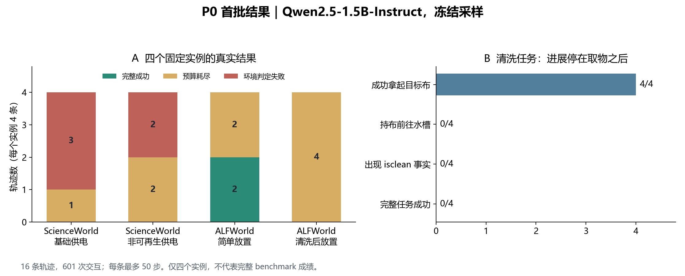
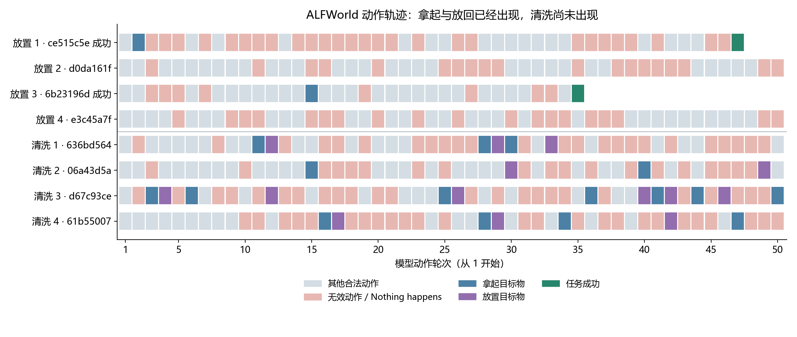
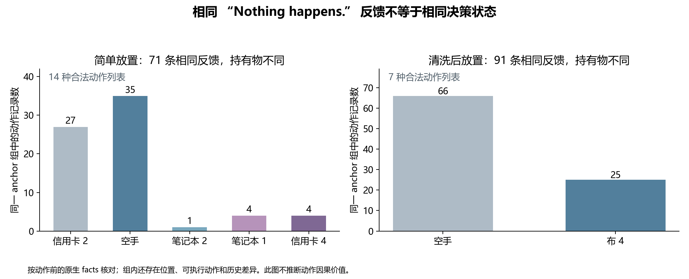

# P0 真实轨迹分析 · Orion · 2026-10-12

**结论：已完成 ScienceWorld 与 ALFWorld 的首批真实采样、指标复核、图和案例。最有价值的下一步是在 ALFWorld 已拿到布的固定前缀上，测试明确的清洗局部目标能否带来后续进展。现有结果提供了阶段接续与分组混合的线索，尚不足以确认 H1/H2/H3，也不能用于比较 GiGPO 与 GRPO 的训练效果。**

本批运行身份为 `frozen_collect`，没有模型参数更新。共 4 个固定 train 实例，每个 4 条轨迹，共 16 条轨迹、601 次模型发出的环境动作。模型为 Qwen2.5-1.5B-Instruct，revision `989aa7980e4cf806f80c7fef2b1adb7bc71aa306`；每条最多 50 个动作、每轮最多输出 512 tokens、输入上限 4096 tokens、历史窗口 4 步，temperature 0.7。终局严格成功奖励 +10，一次支付，格式/非法动作惩罚和 KL 均为 0。以下比例只描述这四个实例，不能视为完整 benchmark 成绩。

| 实例 | 严格成功 | 预算耗尽 | 环境判定失败 | 动作数 | 非零局部优势的动作数 |
|---|---:|---:|---:|---:|---:|
| ScienceWorld：power-component / 7 | 0/4 | 1/4 | 3/4 | 101 | 0/101 |
| ScienceWorld：非可再生能源供电 / 5 | 0/4 | 2/4 | 2/4 | 118 | 0/118 |
| ALFWorld：CreditCard → Sofa | 2/4 | 2/4 | 0/4 | 182 | 130/182 |
| ALFWorld：Clean Cloth → Toilet | 0/4 | 4/4 | 0/4 | 200 | 0/200 |

ScienceWorld 合计 0/8，ALFWorld 合计 2/8。16 条轨迹的最终结果均有记录，未混入之前失败的 ALFWorld 作业 159641。



**观察一：ScienceWorld 当前主要暴露基础命令和对象操作困难，还没有形成可分析的成功接线样本。**

- 219 次动作中，171 次返回原生错误 `No known action matches that input.`，占 78.1%；另有 14 次“门未打开”，6 次连接端子未指明。这里只报告具体反馈，未把其余动作一律判为成功。
- 5 条轨迹因关注错误对象而被环境终止：drawing 两次，hallway、battery、switch 各一次。其最终原生分数为 -100；这属于任务失败，不能当作基础设施错误或超时。
- 基础供电实例从 hallway 起步，四条轨迹均未观察到成功打开门、进入 workshop 的操作。非可再生供电实例从 workshop 起步，主要卡在电池、电线与端子的正确表达上。因此不能把两实例的差别归因于“依赖深度”。
- 两条轨迹最终原生分数为 38，但增加主要伴随对目标绿灯泡的 focus。原始反馈没有成功接线证据，且未保存每步完整电路状态；`wiring_condition_verified` 保持 null。38 分不计为“物理准备完成”。
- 输入截断为 0/219，输出达到 token 上限为 1/219。扩大 token 预算不是当前最直接的处理方向。3 条轨迹用满 50 步；局部历史只有 4 步，记忆因素仍是竞争解释。

可核对案例：`ef89a748-9ee3-409f-be5c-e5cc689ca3e4:0` 第一轮执行 `focus on drawing`，反馈 `You focus on the drawing.`，原生分数 -100 并终止。`619944e7-d886-439f-b6ca-8018495379f7:15` 第 16 轮正确 focus 绿灯泡，分数升到 38；`:19` 查看电池时反馈 anode/cathode 均连接 nothing，最终第 50 轮仍未成功。案例位置使用零基 `analysis_step_id`；正文轮次从 1 开始。

**观察二：ALFWorld 已显示取物与放置能力，清洗条件未被接上。**

清洗任务的目标是 `put a clean cloth in toilet.`。四条轨迹都拿起过 `cloth 4`，也都至少成功把布放到 toilet 一次；共出现 16 次成功取布、14 次成功放布。四条轨迹均没有在持布后成功前往 sinkbasin，动作前的合法动作列表从未出现 `clean cloth ...`。200 个动作后的原生 facts 均无目标 cloth 的 `isclean`。没有一次 `clean cloth` 命令；唯一含 clean 的动作是第 4 条轨迹第 43 轮的 `clean toilet 1`，反馈 `Nothing happens.`。

这支持“取得目标对象之后，没有组织出清洗所需的下一步”这一行为观察。它尚不能区分：对 clean 的任务语义误读、不知道清洗操作、没有主动前往适当位置、局部历史丢失，或更一般的依赖组织问题。尤其是模型从未到达可执行清洗的位置，不能据此断言它不会使用一个已经呈现的合法清洗命令。

典型清洗案例：`d67c93ce-fa86-43ee-9c65-e1ecf55c8846` 第 3 轮成功拿布，第 4 轮原样放回；第 6 轮再拿，第 12 轮再放。后续又多次取放，到第 50 轮仍未出现清洗事实。原始动作包括 `take cloth 4 from toilet 1` 与 `move cloth 4 to toilet 1`，环境确实执行了这些动作。

简单放置提供了一个有限的能力参照。`6b23196d-3561-4d01-a959-826c18bfb082` 在第 15 轮拿到 creditcard 4，第 16 轮带卡到达 sofa 1，直到第 35 轮才正确执行 `move creditcard 4 to sofa 1` 并成功。另一成功轨迹 `ce515c5e-f977-4c26-bdab-802f4ac25019` 在第 2 轮拿到卡，第 22 轮已带卡到沙发，第 47 轮才完成放置。这说明模型能完成这些操作，但有明显绕行和重复；不支持“所有失败都因为放置操作完全不会”。两条失败的放置轨迹则没有成功拿到信用卡。



**观察三：当前优势信号同时受全失败组和反馈文本混合影响。**

ScienceWorld 两组、ALFWorld 清洗组都没有终局成功。由于实际协议只给终局 +10，这些组所有回报、episode advantage 和 step advantage 均为 0。对于这三组，当前数据没有供现有优势计算区分准备动作的回报差异；这不是“GiGPO 已被证明错误估计准备动作价值”的证据。

ALFWorld 简单放置组有两条成功、两条失败，出现 130/182 个非零局部优势。对照记录重算现有 GiGPO core，所有保存的回报与优势数值均一致；组合重构最大误差约 9.54e-7。沿用 core 默认 `compute_mean_std_cross_steps=True`，组均值按展开后的动作记录计算，所以成功轨迹的 episode advantage 是约 +5.4945、失败轨迹约 -4.5055，并非自行换成每轨迹等权的 ±5。

需要注意 anchor 的语义：这里按“任务组 + 动作前的最后反馈文本”精确分组，不代表完整决策状态相同。

| ALFWorld 中同为 Nothing happens. 的组 | 记录数 | 持有物情况 | 不同合法动作列表数 |
|---|---:|---|---:|
| 简单放置 | 71 | 空手 35、creditcard 2 为 27、creditcard 4 为 4、laptop 1 为 4、laptop 2 为 1 | 14 |
| 清洗后放置 | 91 | 空手 66、cloth 4 为 25 | 7 |

该差异来自每个动作之前的原生 facts 和 admissible actions，不是根据输出文字猜测。简单放置组里的 71 个此类 anchor 动作都有非零局部优势。全 ALFWorld 的 54 个正局部优势动作中，有 20 个动作本身返回 `Nothing happens.`。后者只是与后续成功相关的观测，不能单凭正优势断言这些动作具有正向因果作用。

原指标“首步之后、同 anchor 跨轨迹不同动作的覆盖率”为 237/295（80.3%）。额外要求“记录的完整 native facts 集合严格相同”后，本次保守诊断为 2/295。完整 facts 包含派生/历史谓词，不同 facts 也未必意味着任务相关物理状态不可等价；该结果只用于提示进一步审查，不作为校正后的真实可比较率。ScienceWorld 没有完整状态快照，对应指标留空。



**数据口径与边界。**

- ALFWorld 实际合法动作 217/382（56.8%）；其余 165 次均反馈 `Nothing happens.`。它们中也包括已在该位置却重复 go、对未持有物体执行 move 等状态不适用动作，不应全部称为语法错误。
- 原 `parse_valid` 为 303/382（79.3%），同时检查标签、think 和“回答是否含中文”。实际上 379/382 有完整 action 标签；76 条回答含中文，37 条被标记不合规的回答仍执行了合法动作。本批未施加格式惩罚，所以没有因这些标记把奖励改掉。
- 所有 601 个动作均无输入截断；ALFWorld 输出达到上限 0/382，ScienceWorld 1/219。没有发生采样期间环境异常。
- 对 facts、目标持有、`isclean` 和清洗菜单的补充标签存入独立 `condition_annotations.jsonl`，未覆盖原始记录、奖励和原 metrics。`isclean` 使用原生谓词成员关系；没有 facts 或条件不适用时保留 null。ScienceWorld 接线条件保持 unknown。
- facts 与原始 `extra.expert_plan` 只存在于记录中；检查了实际提示构造路径，未把它们追加进 actor 提示。模型看到任务、当前观察、四步历史和合法动作/动作模板。分析阶段也没有让模型重新执行动作。
- ALFWorld 工作于独立 Python 3.10 子进程；主进程 manifest 中 `alfworld: null` 不能解释为环境未安装。子进程准确包版本没有归档，这是后续记录需要补齐的一项可复现性限制。
- 所有实例属于 train/discovery；样本少，没有显著性、泛化或算法优越性结论。P0 此阶段可以交付。AppWorld 早期交互、HPC 固定前缀对照、实际参数更新和 P2 独立动作分支均尚未运行。

**下一轮最有价值的两项行动。**

1. 保持 1.5B，先做 ALFWorld 清洗任务的两个真实固定前缀。按原轨迹顺序选前两条清洗轨迹的首次成功拿布：`636bd564-6758-4fdf-bce0-633499b75de6:10`（已用 11 轮，剩 39 轮）与 `06a43d5a-ed78-428a-942e-0e89cdd5a77f:14`（已用 15 轮，剩 35 轮）。分别比较原目标续接与额外提示 `Clean the cloth you are holding.`，每个条件 2 个配对 seed，共 8 条续接、最多 296 次新动作。两条件保持对应前缀、可见历史、token 预算、剩余轮数和两个评价终点一致：目标布首次 `isclean` 与原 50 轮终点严格完成。提示提供额外信息，但不给动作序列。已保存 `next_probe_manifest.json`，尚未执行；现有 `probes.py` 仅支持 ScienceWorld，下一步需要补一个最小 ALFWorld 重放适配。
2. ScienceWorld 在现有 workshop 起点的少量真实前缀上做局部接线能力诊断，先核对 replay，再用明确的单一连接目标检验 1.5B 是否能执行必要操作。如明确局部目标后仍失败，再考虑同任务少量更强模型参照。当前不扩大训练、不改奖励，也不以增加大批样本替代能力诊断。

原运行没有完整模拟器/RNG 快照。后续前缀需逐步比对 observation、facts、合法动作、可见历史，并检查两个条件的起始记录一致；仍标注 reconstructed/approximate replay。局部提示若改善清洗，才进一步研究目标衔接；若无改善，则优先核对操作与环境接口知识。H2 的后续动作分支以获得同一前缀的独立后缀证据为前提。

**运行与复现记录。**

| 项目 | ScienceWorld | ALFWorld |
|---|---|---|
| Slurm job | 159640 | 159657 |
| 采样 commit | `6e078d03f39a9a7bcc0de0b6a334455606abfe5d` | `d4327c9a9eb54d39070512e6b173342fe6579b91` |
| run 目录名 | `scienceworld-collect-20261012T094001Z-8ecf63` | `alfworld-collect-20261012T095303Z-d56e91` |
| SwanLab | [by9iplrh](https://swanlab.cn/@KANSEI/gigpo-dependency-pilot/runs/by9iplrh) | [r7r3162r](https://swanlab.cn/@KANSEI/gigpo-dependency-pilot/runs/r7r3162r) |

实验分支：`exp/dep-prep-pilot-20261012`。两个采样 commit 的差异是环境通信修复，没有改变模型、提示、奖励或采样预算。

HPC 命令由用户执行：

```bash
cd /scratch/prjsnnn0000269/Students/shuming/cjk/code/verl-agent-dep-prep-pilot
sbatch recipe/dependency_pilot/orion/collect.sbatch scienceworld
sbatch recipe/dependency_pilot/orion/collect.sbatch alfworld
```

作业内实际采样入口：`python -m recipe.dependency_pilot.run collect --env ENV --profile smoke --swanlab-mode cloud`，其中 ENV 分别为 scienceworld / alfworld。HPC run 根目录：`/scratch/prjsnnn0000269/Students/shuming/cjk/logs/dependency_pilot`。每次运行的确切配置见原目录中的 `resolved_config.json` / `.yaml`，版本与命令见 `run_manifest.json`。

下载包：`C:\Users\19096\Downloads\dep-prep-p0-results-20261012.tar`。本地导入根目录：`C:\Users\19096\Desktop\verl-agent\outputs\dependency_pilot\hpc-20261012`。本报告、三张图（PNG/SVG）、完整动作案例、601 条补充条件记录、`analysis.json`、`verification.json` 和下一轮前缀清单位于 `review-final`。原 HPC 图表与指标保留在两个原始 run 目录。此次新增分析保存在本地，未额外上传 SwanLab。

本地实际分析命令：

```powershell
& 'C:\Users\19096\Desktop\verl-agent\tmp\dep-prep-local\Scripts\python.exe' -B 'C:\Users\19096\Desktop\verl-agent\tmp\dep-prep-review\review_hpc.py' --input 'C:\Users\19096\Desktop\verl-agent\outputs\dependency_pilot\hpc-20261012' --output 'C:\Users\19096\Desktop\verl-agent\outputs\dependency_pilot\hpc-20261012\review-final' --repo 'C:\Users\19096\.codex\worktrees\dep-prep-pilot\verl-agent'
```

该脚本另保存为实验分支 `recipe/dependency_pilot/review_downloaded.py`。复跑时指定新的输出目录以保留已有结果；本地绘图与 Torch 数值复核使用分开的进程，避免 Windows/Anaconda 的 OpenMP 冲突，没有启用重复运行库忽略开关。最初两个出图失败的尝试位于 `review-v1` / `review-v2`；交付以 `review-final` 为准。

校验包括原始文件 SHA256、轨迹和动作 ID、动作顺序、实际 token 数与输入哈希、终止结果、奖励一次支付、组大小、全部已保存指标及 GiGPO 数值。两个运行的保存数值与本地重算结果完全一致；分析前后原始导入文件哈希均不变。本地 Torch 为 2.10.0+cu126，HPC 为 2.8.0+cu126，环境差异已保留，不冒称相同执行环境。
